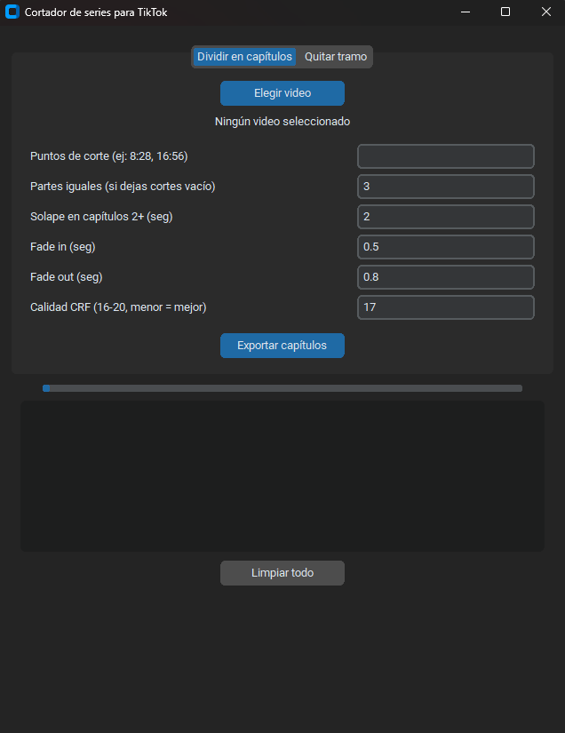

# Cortador de series para TikTok

Aplicación de escritorio con interfaz gráfica para preparar videos largos antes de subirlos a TikTok (o a cualquier plataforma). Usa **FFmpeg** por debajo, así que conserva la calidad en 1080p.



## Qué hace

**Dividir en capítulos**

- Parte un video en la cantidad de capítulos que quieras, por tiempos exactos o en partes iguales.
- Aplica fundido de entrada y salida (imagen y audio) a cada capítulo.
- Los capítulos 2 en adelante empiezan unos segundos antes, para que el espectador recuerde dónde quedó la historia.

**Quitar tramo**

- Elimina un tramo del video (por ejemplo, una parte con música que la plataforma rechaza) y une las dos partes restantes con un fundido corto.

Todo se recodifica una sola vez con `libx264`, `CRF 17` y `preset slow`, que es prácticamente indistinguible del original.

## Requisitos

- **Python 3.10 o superior** (probado con 3.14)
- **FFmpeg** (incluye `ffprobe`) disponible en el PATH
- Probado en **Windows 11**. En macOS y Linux debería funcionar, pero no está probado.

## Instalación (se hace una sola vez )

1. Instala [Python](https://www.python.org/downloads/) y marca **"Add python.exe to PATH"** durante la instalación.

2. Instala FFmpeg. En Windows:

   ```bash
   winget install Gyan.FFmpeg
   ```

   Cierra y vuelve a abrir la terminal, y verifica que ambos respondan:

   ```bash
   ffmpeg -version
   ffprobe -version
   ```

3. Clona el repositorio y entra a la carpeta:

   ```bash
   git clone https://github.com/TU_USUARIO/cortador-series-tiktok.git
   cd cortador-series-tiktok
   ```

4. Crea el entorno virtual (una carpeta `.venv` donde viven las librerías de este proyecto):

   ```bash
   python -m venv .venv
   ```

5. Actívalo (ver la siguiente sección) e instala las dependencias:

   ```bash
   pip install -r requirements.txt
   ```

## Cómo ejecutarlo cada vez

El entorno virtual **se activa por terminal**: cada vez que abres una terminal nueva (o reinicias tu editor) empieza _sin_ entorno. Si ejecutas el programa sin activarlo, verás `ModuleNotFoundError: No module named 'customtkinter'`, porque la librería está instalada dentro del `.venv` y no en tu Python global.

**Paso 1. Entra a la carpeta del proyecto**

```bash
cd cortador-series-tiktok
```

**Paso 2. Activa el entorno** (elige según tu terminal):

| Terminal      | Cómo reconocerla                  | Comando                         |
| ------------- | --------------------------------- | ------------------------------- |
| Git Bash      | Muestra `MINGW64` en el prompt    | `source .venv/Scripts/activate` |
| PowerShell    | El prompt empieza con `PS C:\...` | `.venv\Scripts\Activate.ps1`    |
| CMD           | El prompt es `C:\...>`            | `.venv\Scripts\activate.bat`    |
| macOS / Linux |                                   | `source .venv/bin/activate`     |

Sabrás que funcionó porque aparece **`(.venv)`** al inicio de la línea:

```
(.venv) usuario@PC ~/cortador-series-tiktok
```

Atención en Git Bash: usa siempre `/` en las rutas. La barra invertida `\` se interpreta como carácter de escape y el comando falla.

**Paso 3. Ejecuta el programa**

```bash
python cortador.py
```

**Para salir del entorno:** escribe `deactivate`.

### Alternativas sin activar nada

- **Llamar directo al Python del entorno** (funciona desde cualquier terminal, sin activar):

  ```bash
  .venv/Scripts/python cortador.py
  ```

- **Doble clic en Windows:** usa el archivo `ejecutar.bat` incluido en el repositorio. Abre el programa sin necesidad de terminal.

- **Desde VS Code o Cursor:** `Ctrl+Shift+P` → **Python: Select Interpreter** → elige el que dice `.venv`. A partir de ahí, el editor activa el entorno solo cada vez que abres una terminal nueva dentro de él.

## Uso

### Pestaña "Dividir en capítulos"

| Campo              | Qué hace                                                                                                                                              |
| ------------------ | ----------------------------------------------------------------------------------------------------------------------------------------------------- |
| Puntos de corte    | Momentos donde **termina** cada capítulo, separados por coma (`8:28, 16:56`). N cortes producen N+1 capítulos. Si lo llenas, ignora "Partes iguales". |
| Partes iguales     | Cantidad de capítulos de igual duración (no la duración de cada uno). Solo se usa si no hay puntos de corte.                                          |
| Solape             | Segundos que los capítulos 2+ retroceden al inicio. `0` = corte seco.                                                                                 |
| Fade in / Fade out | Duración del fundido al inicio y al final de cada capítulo. `0` = sin fundido. Mantén el fade in menor que el solape.                                 |
| Calidad CRF        | 16-20. Menor = más calidad y más peso. 17 es casi idéntico al original.                                                                               |

Los capítulos se guardan junto al video original como `nombre_parte1.mp4`, `nombre_parte2.mp4`, etc.

### Pestaña "Quitar tramo"

1. Elige el video.
2. Escribe el inicio y el fin del tramo a eliminar (`2:10` y `3:45`). Los tiempos son del archivo que cargaste.
3. Elige la duración del fundido en la unión (`0` = corte seco).
4. El resultado se guarda como `nombre_sin_tramo.mp4`.

El tramo debe estar en medio del video, no pegado al inicio ni al final.

### Botón "Limpiar todo"

Vacía el registro, la barra de progreso, el video seleccionado y los tiempos de corte. No borra ningún archivo exportado.

## Consejos

- Corta en un giro de la historia o una frase fuerte, no en una pausa muerta.
- Si necesitas quitar un tramo y además dividir, **quita el tramo primero** y divide después: así recodificas una sola vez.
- Deja 1 o 2 segundos de margen alrededor de lo que quieres quitar.
- Prueba siempre con un clip corto antes de procesar un video de 25 minutos.

## Problemas frecuentes

**`ModuleNotFoundError: No module named 'customtkinter'`**
El entorno virtual no está activo en esta terminal. Mira la sección "Cómo ejecutarlo cada vez": activa el entorno (debe aparecer `(.venv)`) o ejecuta con `.venv/Scripts/python cortador.py`.

**`FileNotFoundError` o "ffmpeg no encontrado"**
FFmpeg no está en el PATH. Reinstálalo y reabre la terminal y el editor.

**Windows bloquea ffmpeg ("Una directiva de Control de aplicaciones bloqueó este archivo")**
Es Smart App Control, que bloquea ejecutables sin firma. Puedes desactivarlo en _Seguridad de Windows → Control de aplicaciones y navegador_. Es irreversible sin reinstalar Windows: decide tú.

**PowerShell: "la ejecución de scripts está deshabilitada"**
Ejecuta una vez: `Set-ExecutionPolicy -Scope CurrentUser RemoteSigned`

**En Git Bash: `.venvScriptsActivate.ps1: command not found`**
Escribiste el comando con `\`. En Git Bash se usa `source .venv/Scripts/activate`.

**"Este archivo no contiene video"**
La extensión `.mp4` no garantiza el contenido. Puede ser un archivo de subtítulos u otro formato con nombre equivocado.

**"No pude determinar la duración"**
El archivo no tiene marcas de tiempo válidas o está dañado. Prueba con el video original exportado desde tu editor.

## Crear un .exe (opcional)

```bash
pip install pyinstaller
pyinstaller --onefile --windowed cortador.py
```

El ejecutable queda en `dist/`. Ten en cuenta que no va firmado: Windows o tu antivirus pueden bloquearlo o marcarlo como sospechoso. Y FFmpeg sigue siendo un requisito aparte.

## Aviso

Usa esta herramienta solo con contenido propio o con autorización de sus titulares. No garantiza que una plataforma acepte el video resultante, y cada quien es responsable de cumplir las normas de la plataforma donde publica.

## Licencia

MIT. Consulta el archivo `LICENSE`.

## Contribuir

Se aceptan issues y pull requests. Ideas pendientes: cola de varios videos, duración fija por capítulo, formato vertical 9:16 con fondo difuminado.
